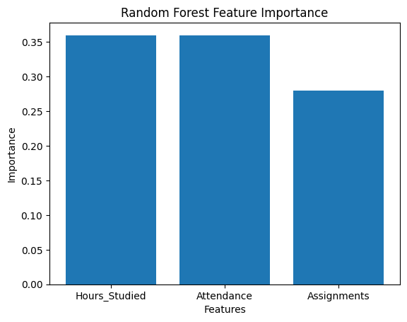

# 9. Random Forest

[Back to experiments](../README.md)

[Python source](11259A220_random_forest.py) | [Dataset](11259A220_11259A220_11259A220_11259A220_11259A220_11259A220_11259A220_11259A220_11259A220_11259A220_11259A220_data.csv) | [Text output](11259A220_11259A220_11259A220_11259A220_11259A220_11259A220_11259A220_11259A220_11259A220_11259A220_11259A220_11259A220_output.txt)

## Code

```python
import pandas as pd
from sklearn.model_selection import train_test_split
from sklearn.ensemble import RandomForestClassifier
from sklearn.metrics import accuracy_score, confusion_matrix, classification_report
import matplotlib.pyplot as plt
# Load dataset
data = pd.read_csv("11259A220_11259A220_11259A220_11259A220_11259A220_11259A220_11259A220_11259A220_11259A220_11259A220_11259A220_data.csv")
# Input features
X = data[['Hours_Studied','Attendance','Assignments']]
# Target variable
y = data['Result']

# Split dataset into training and testing sets
X_train, X_test, y_train, y_test = train_test_split(X, y, test_size=0.2, random_state=42)
# Create Random Forest model
model = RandomForestClassifier(n_estimators=100,random_state=42)
# Train the model
model.fit(X_train, y_train)
# Predict test data
y_pred = model.predict(X_test)
# Evaluate performance
print("Accuracy", accuracy_score(y_test, y_pred))
print("\nConfusion Matrix:")
print(confusion_matrix(y_test, y_pred))
print("\nClassification Report:")
print(classification_report(y_test, y_pred))
# Feature Importance Graph
importance = model.feature_importances_
plt.bar(X.columns, importance)
plt.xlabel("Features")
plt.ylabel("Importance")
plt.title("Random Forest Feature Importance")
plt.show()
```

## Output

```text
Accuracy: 1.0

Confusion Matrix:
[[2 0]
 [0 2]]

Classification Report:
              precision    recall  f1-score   support

        Fail       1.00      1.00      1.00         2
        Pass       1.00      1.00      1.00         2

    accuracy                           1.00         4
   macro avg       1.00      1.00      1.00         4
weighted avg       1.00      1.00      1.00         4
```

## Graphs




## Run

From this experiment folder, run: `python 11259A220_random_forest.py`.

